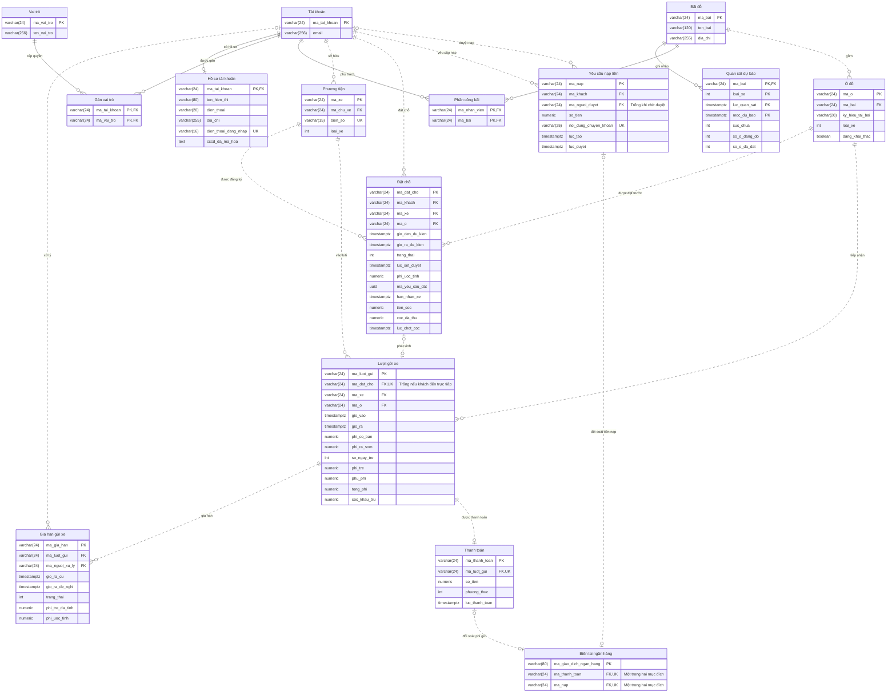

# ERD đề xuất cho hệ thống quản lý bãi đỗ xe

[Mở sơ đồ SVG để phóng to hoặc đưa vào báo cáo](erd-tieng-viet.svg)

[Mở SQL PostgreSQL của 15 bảng nghiệp vụ và hai view](thiet-ke-v2.sql)

Để xem thiết kế trong pgAdmin hoặc DBeaver trên máy phát triển này, mở database `parking_thiet_ke_v2` rồi chọn **Schemas → bai_xe_v2 → Tables**. Để dựng trên máy khác, tạo một database trống, kết nối đến đó và chạy toàn bộ file SQL. Script cũng nâng cấp bản 13 bảng tại chỗ, giữ nguyên dữ liệu và các mã đã cấp. Ứng dụng hiện tại vẫn kết nối đến `parking_db`.

Đọc từ **Đặt chỗ → Lượt gửi xe → Thanh toán** để theo dõi một lần gửi xe. Đọc từ **Tài khoản → Phân công bãi → Bãi đỗ** để xác định nhân viên nào được theo dõi lịch đã xác nhận, nhận xe và xem doanh thu tại bãi đó.

Đây là thiết kế đích cho các bảng nghiệp vụ của Smart Parking. Tên hiển thị dùng tiếng Việt có dấu. Tên cột dùng tiếng Việt không dấu để có thể dùng trực tiếp trong PostgreSQL. Các trường kỹ thuật do ASP.NET Core Identity quản lý như token, claim, đăng nhập ngoài và thông tin xác thực được lược khỏi sơ đồ nghiệp vụ.

## Sơ đồ quan hệ

`PK` là khóa chính, `FK` là khóa ngoại, `UK` là giá trị duy nhất. Các cột đánh dấu `PK` trong cùng một bảng tạo thành một khóa chính ghép. Ở đầu đường nối, vòng tròn biểu thị tùy chọn, vạch đứng biểu thị một và chân quạ biểu thị nhiều. Sơ đồ thể hiện các cột chính, các ràng buộc liên bảng được giải thích bên dưới.

## Cách đọc khóa chính

Người dùng có thể đăng nhập bằng email hoặc số điện thoại đã chuẩn hóa cùng mật khẩu. **Hồ sơ tài khoản** lưu tên người dùng, số điện thoại liên hệ, địa chỉ và CCCD tùy chọn. CCCD được mã hóa khi lưu. Trang **Tài khoản** chỉ hiển thị bốn số cuối và cho phép chủ tài khoản thay hoặc xóa CCCD.

| Bảng | Ví dụ khóa chính | Ý nghĩa |
| --- | --- | --- |
| Tài khoản, Hồ sơ tài khoản | `TK-000125` | Hồ sơ dùng lại mã tài khoản 125. Mã vẫn dùng được khi người dùng đổi vai trò. |
| Vai trò | `VT-NHANVIEN`, `VT-QUANTRI` | Mã tiếng Việt tương ứng với tên quyền `Staff`, `Admin` trong ứng dụng. Khách hàng hiện là tài khoản mặc định khi chưa được cấp hai quyền này. |
| Gán vai trò | (`TK-000125`, `VT-NHANVIEN`) | Tài khoản 125 có quyền nhân viên. |
| Bãi đỗ | `BAI-DN-0004` | Bãi số 4 thuộc Đà Nẵng khi cấp mã. |
| Phân công bãi | (`TK-000125`, `BAI-DN-0004`) | Nhân viên 125 phụ trách bãi số 4. |
| Ô đỗ | `O-DN-0004-0011` | Ô nội bộ thứ 11 tại bãi số 4. Biển chỉ dẫn như `M11` được lưu riêng để có thể đổi tên. |
| Phương tiện | `XE-000312` | Hồ sơ xe số 312. Biển số là thuộc tính tra cứu riêng. |
| Đặt chỗ | `DC-20261120-000039` | Yêu cầu đặt chỗ tạo ngày 20/11/2026, số thứ tự 39. |
| Lượt gửi xe | `LG-20261121-000014` | Lượt nhận xe ngày 21/11/2026, số thứ tự 14. |
| Thanh toán | `TT-20261123-000008` | Khoản thanh toán ghi nhận ngày 23/11/2026, số thứ tự 8. |
| Yêu cầu nạp tiền | `NAP-20261119-000005` | Yêu cầu nạp tiền tạo ngày 19/11/2026, số thứ tự 5. |
| Gia hạn gửi xe | `GH-20261123-000001` | Mỗi lần đề nghị gia hạn có một mã riêng. |
| Quan sát dự báo | (mã bãi, loại xe, lúc quan sát, mốc dự báo) | Một bản ghi cho mỗi mốc dự báo của bãi và loại xe. |
| Biên lai ngân hàng | `FT26324000123` | Ví dụ minh họa mã giao dịch do ngân hàng cấp. Dùng chính mã đã chuẩn hóa để đối soát. |

Các mã nội bộ dùng `varchar(24)`. Mã ngân hàng dùng `varchar(80)` theo giới hạn đối soát hiện có. Mỗi FK dùng cùng kiểu và độ dài với PK mà nó tham chiếu. Tiền dùng `numeric(12,2)`, đơn vị đồng. Thời điểm lưu bằng `timestamptz`; phần ngày trong mã được chốt một lần theo giờ Việt Nam lúc tạo bản ghi. Phần số được cấp nguyên tử bằng sequence hoặc bộ đếm có khóa. Tên bãi, biển số, vai trò, thời gian đặt và thông tin liên hệ đều có thể thay đổi độc lập với khóa.

## Ràng buộc cần giữ khi triển khai

- **Phân quyền theo bãi.** Cặp nhân viên và bãi là duy nhất. Danh sách lịch đặt, nhận xe và doanh thu của nhân viên đều lọc qua bảng **Phân công bãi**. Quản trị viên có quyền trên toàn hệ thống.
- **Đặt chỗ và nhận xe.** Xe phải thuộc khách đặt và đúng loại ô. Ký hiệu ô là duy nhất trong mỗi bãi. Giờ ra dự kiến phải sau giờ đến. Một ô hoặc một xe chỉ có tối đa một lượt gửi đang mở. Với lượt gửi theo đơn, ô và xe phải khớp đơn đã xác nhận. Thiết kế thêm ràng buộc duy nhất cho mã đặt chỗ trên lượt gửi để mỗi đơn chỉ dùng được một lần.
- **Tính phí.** Đơn đặt lưu đơn giá giờ, phí ra sớm, phí trễ theo ngày và phụ phí tại thời điểm đặt. Khi xe ra, lượt gửi lưu số giờ tính tiền và từng khoản phí thực tế. Tổng phí bằng phí cơ bản cộng phí ra sớm, phí trễ và phụ phí. Mỗi lượt gửi có tối đa một lần thanh toán thành công.
- **Đối soát QR.** Thiết kế đề xuất cho mỗi biên lai tham chiếu đúng một khoản thanh toán hoặc một yêu cầu nạp. Trong PostgreSQL có thể dùng `CHECK (num_nonnulls(ma_thanh_toan, ma_nap) = 1)`, kết hợp `UNIQUE` trên từng FK. Nhờ vậy cùng một giao dịch ngân hàng chỉ ghi nhận được một lần. Mã tham chiếu để khách ghi trong nội dung chuyển khoản khác với mã giao dịch ngân hàng cấp sau khi chuyển.
- **Cọc giữ chỗ.** Đơn mới dùng trạng thái 1 (đã xác nhận), tiền cọc bằng một giờ gửi. Các trạng thái còn lại là 2 (đã hủy), 3 (đã dùng), 4 (chờ duyệt theo luồng cũ), 5 (từ chối), 6 (hết hạn xác nhận) và 7 (vắng mặt). Mã yêu cầu UUID là duy nhất cho mỗi khách, dùng để xử lý gửi lại. Hạn nhận xe là giờ đến cộng 15 phút hoặc giờ kết thúc đã đặt, lấy mốc sớm hơn.
- **Quyết toán cọc.** Khi đang giữ cọc, `coc_da_thu` và `luc_chot_coc` để trống. Hủy trước giờ đến hoặc bãi chủ động hủy thì ghi số tiền thu bằng 0. Khách hủy muộn hoặc vắng mặt thì thu cọc. Khi trả xe, chốt phần cọc dùng trả phí và ghi cùng số tiền vào `luot_gui_xe.coc_khau_tru`. Phần dư được trả về số dư khả dụng. Nếu cọc đủ trả phí, ghi thanh toán phương thức 5 với số tiền thu thêm bằng 0.
- **Số dư và doanh thu.** View `so_du_khach_hang` lấy tiền nạp đã duyệt trừ tiền ví trả thêm và tiền cọc đang giữ hoặc đã thu. View `khoan_thu_theo_bai` ghi riêng tiền cọc đã thu tại thời điểm chốt và phần phí thu thêm tại thời điểm thanh toán. Báo cáo nhóm theo bãi và thời điểm thu ở múi giờ Việt Nam.
- **Gia hạn.** Một lượt gửi có nhiều lần gia hạn, tối đa một yêu cầu đang chờ. Trạng thái 1 là chờ xử lý, 2 là chấp nhận, 3 là từ chối và 4 là hủy. Lưu giờ ra cũ, giờ ra đề nghị, phí dự kiến và phí trễ đã phát sinh. Người xử lý có thể để trống khi hệ thống tự xác nhận.
- **Học máy.** Mỗi mẫu lưu sức chứa, số ô đang có xe tại lúc quan sát và số ô đã có lịch tại mốc dự báo. Số ô thực tế ở thời điểm đích có thể đối chiếu từ lịch sử lượt gửi xe.

## Đối chiếu với dự án hiện tại

Tài khoản, vai trò và gán vai trò tương ứng với `AspNetUsers`, `AspNetRoles`, `AspNetUserRoles`. Các bảng còn lại lần lượt ánh xạ tới `AccountProfiles`, `ParkingLots`, `StaffParkingLots`, `ParkingSpots`, `Vehicles`, `Reservations`, `ParkingSessions`, `Payments`, `WalletTopUps`  và `BankReceipts`. Hai bảng **Gia hạn gửi xe** và **Quan sát dự báo** tương ứng với `ParkingExtensions` và `ForecastObservations`.

Bản thiết kế bổ sung liên kết biên lai đến giao dịch, khóa ngoại cho người duyệt nạp và tính duy nhất của mã đặt chỗ trên lượt gửi. Khi chuyển dữ liệu cũ, cần lập bảng đối chiếu mã cũ → mã mới, cập nhật cả các FK của Identity và kiểm tra lịch sử đặt chỗ, thanh toán, số dư trước khi chuyển ứng dụng sang bộ khóa mới. Script SQL chỉ quản lý schema thiết kế `bai_xe_v2`.

SQL cấp mã tự động cho tài khoản, bãi Đà Nẵng, xe, đơn đặt, lượt gửi, gia hạn, thanh toán và yêu cầu nạp. Số thứ tự tăng theo từng loại bản ghi xuyên suốt các ngày và có thể có khoảng trống. Người lập danh mục nhập mã vai trò và mã ô. Mã biên lai lấy từ giao dịch ngân hàng. Các quy tắc về quyền nhân viên, khung giờ còn chỗ, loại xe và trạng thái duyệt thuộc luồng xử lý của API khi tích hợp thiết kế.
